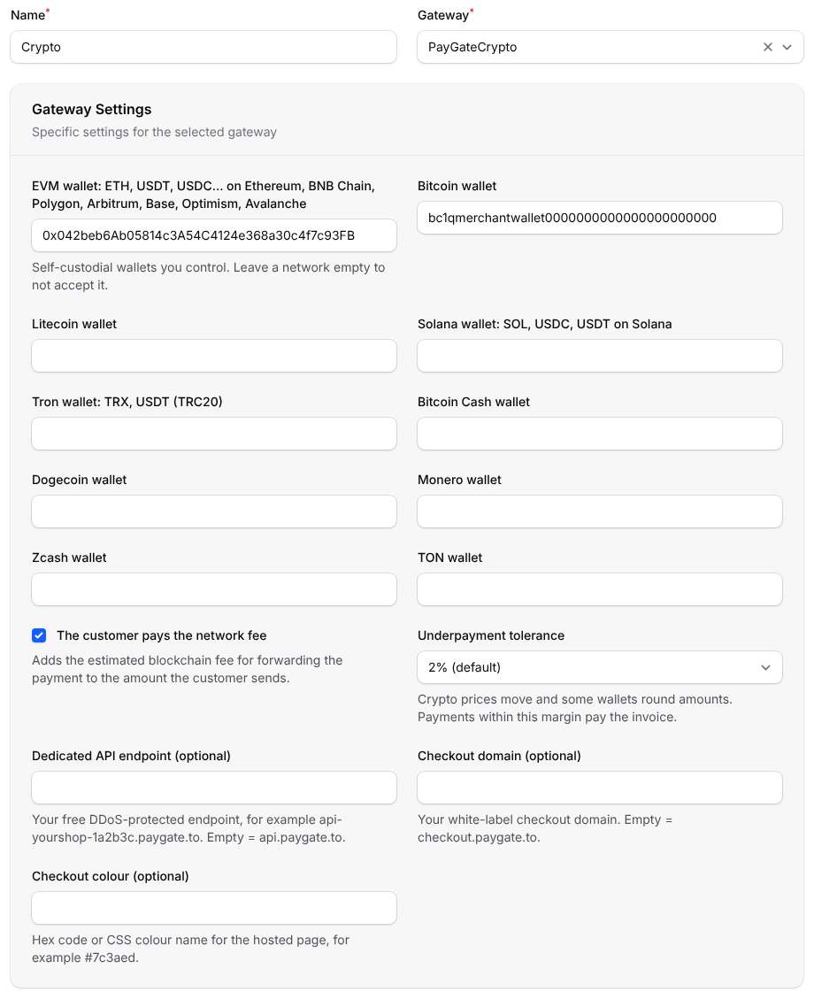
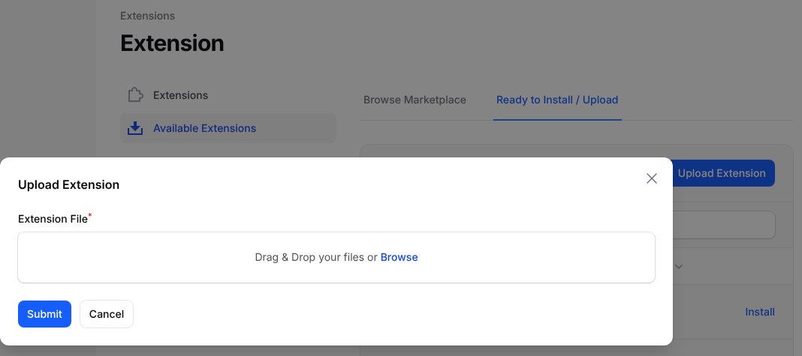
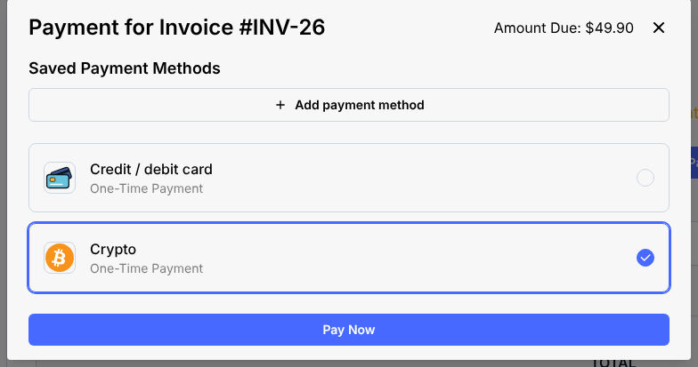
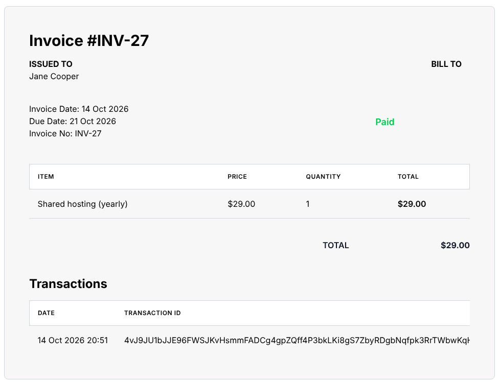

# Crypto Payment Gateway Paymenter
Accept Bitcoin, Ethereum, USDT, USDC, Solana, Litecoin, Monero, Zcash and more on your Paymenter invoices. Every payment is forwarded instantly to your own wallets. No KYC, no sign up.

> 💳 **Want cards too?** Our free [Paymenter card extension](https://github.com/paygate-to/Paymenter-Instant-Payment-Gateway) accepts Visa, Mastercard, Apple Pay and Google Pay with instant USDC payouts.

## Features

- The only crypto payment gateway with **instant payouts for Solana (SOL), Monero (XMR), Zcash (ZEC) and Bitcoin (BTC)**.
- **Hosted multi-coin page**: the client picks any coin of the networks you accept and sees the exact amount, the address and a QR code.
- **No sign up, no API keys, no KYC** for you or your clients. Your wallet addresses are all you need.
- Installs from the admin area: upload the ZIP under **Extensions**, no server access needed.
- Optional: the client pays the blockchain fee.
- Optional: an underpayment tolerance.
- **Secure confirmations**:
  - every payment confirmation is signed by PayGate.to and checked against the bundled public key;
  - every callback URL is signed with your `APP_KEY`;
  - only confirmed payments are credited, and repeated or simultaneous confirmations are credited once;
  - the payout must go to your wallets, and the amount is priced in the coin the client chose and checked before the invoice is paid.
- Works with your own checkout domain and a free dedicated API endpoint ([custom domain guide](https://paygate.to/white-label-api-custom-domain-guide/)).
- Fees: **1.5% + blockchain fees**.

📘 **Step-by-step guide:** [https://paygate.to/crypto-payment-gateway-no-kyc-instant-payouts/paymenter/](https://paygate.to/crypto-payment-gateway-no-kyc-instant-payouts/paymenter/)



## Requirements

- **Paymenter 1.4 or newer.** Tested on 1.5.9.
- Paymenter must be reachable at its public **https** address, and **Settings › General › App URL** must be that address. Payment confirmations are sent to `https://your-site/extensions/gateways/paygatecrypto/callback`.
- A self-custodial wallet address for each network you want to accept.

## Installation

1. **Prepare your wallets**, one per network:
   - **EVM**: one `0x` address for ETH, USDT and USDC on Ethereum, BNB Chain, Polygon, Arbitrum, Base, Optimism and Avalanche.
   - **Bitcoin, Litecoin, Bitcoin Cash, Dogecoin, Solana, Tron (TRX and USDT TRC20), Monero, Zcash and TON**.

   Use wallets only you control: Trust Wallet, Exodus, Phantom, Cake Wallet, or a hardware wallet. **Never use exchange deposit addresses.**
2. **Download** [Paymenter-Crypto-Payment-Gateway-main.zip](https://github.com/paygate-to/Paymenter-Crypto-Payment-Gateway/archive/refs/heads/main.zip). Keep it zipped.
3. **Upload it.** In the Paymenter admin area, go to **Extensions › Available Extensions**, open the **Ready to Install / Upload** tab, click **Upload Extension**, choose the ZIP and click **Submit**. Paymenter installs it as the **PayGateCrypto** gateway.

   

   <details><summary>No upload button, or uploads are blocked on your server?</summary>

   Unzip the file and copy its contents (`PayGateCrypto.php` and the `keys` folder) to `extensions/Gateways/PayGateCrypto/` of your Paymenter installation:

   ```
   Paymenter-Crypto-Payment-Gateway-main/      <paymenter>/extensions/Gateways/
   ├── PayGateCrypto.php     ── copy ──►        └── PayGateCrypto/
   └── keys/                                        ├── PayGateCrypto.php
                                                    └── keys/paygate_callback_public_v1.pem
   ```
   </details>

4. **Add the gateway.** Go to **Gateways**, click **New gateway**, enter a **Name** your clients will see (for example "Crypto (Bitcoin, USDT, Solana…)"), choose **PayGateCrypto** under **Gateway**, and fill in:

   | Field | What to enter |
   |---|---|
   | Network wallets | Your wallet for each network you accept. Leave a network empty to not accept it. |
   | The customer pays the network fee | Tick to add the estimated blockchain fee to the amount the client sends. |
   | Underpayment tolerance | Payments within this margin pay the invoice. Default 2%. |
   | Dedicated API endpoint | Optional: your free endpoint, e.g. `api-yourshop-1a2b3c.paygate.to` |
   | Checkout domain, colour | Optional white-label settings for the hosted page |

   Click **Create**.
5. **Test with an invoice.** The client opens the invoice, clicks **Pay**, chooses the crypto method, clicks **Pay Now** and picks a coin on the hosted page. When the payment is confirmed on the blockchain, the crypto is forwarded to your wallet and the invoice is marked **Paid**.



## Where to see payments

Each confirmed payment becomes a transaction with the blockchain transaction id. You see them under **Invoice › Invoice Transactions** (with their status), on the invoice in the admin area, and on the client's invoice page.

| Transaction | Meaning |
|---|---|
| Status *Succeeded*, the invoice amount | The invoice was paid. |
| Status *Failed*, amount 0 | A payment arrived but did not pay the invoice. The reason is in the Paymenter log (`storage/logs`): *underpaid* beyond your tolerance, an unknown coin, a payout that did not go to your wallets, or an *extra payment* on an invoice that was already paid or cancelled. Settle with the client. |

The invoice is priced in the coin the client chose when the confirmation arrives, so a coin that moves a lot while the payment confirms can turn an exact payment into an underpayment: raise the **Underpayment tolerance** if that happens often. Account credit top-ups always need at least 98% of the amount. Confirmations that are not genuine, or were changed, are refused and nothing is recorded.

Each coin has a minimum ([see the minimums](https://paygate.to/crypto-payment-gateway-no-kyc-instant-payouts/#minimumorder)). Below it, the hosted page asks the client to choose another coin.



## Updating

Upload the new ZIP the same way. Paymenter replaces the files and keeps your gateway settings.

## Troubleshooting

- **PayGateCrypto is not in the Gateway list.** Check that `extensions/Gateways/PayGateCrypto/PayGateCrypto.php` exists, then reload the page.
- **"This payment method is not available right now".** Fill in the wallet of at least one network.
- **The client paid but the invoice is still unpaid.**
  - Look for the invoice under **Invoice › Invoice Transactions**.
  - If there is none, the payment may still be confirming on the blockchain. Otherwise the confirmation could not reach your site: check that **Settings › General › App URL** is your public https address, and that nothing (maintenance mode, a firewall, IP allow-lists) blocks `/extensions/gateways/paygatecrypto/callback`.
  - A *Failed* transaction tells you why in `storage/logs`; see the table above.

Full product page: [https://paygate.to/crypto-payment-gateway-no-kyc-instant-payouts/](https://paygate.to/crypto-payment-gateway-no-kyc-instant-payouts/) · Support: [Telegram](https://t.me/PayGate_to)
